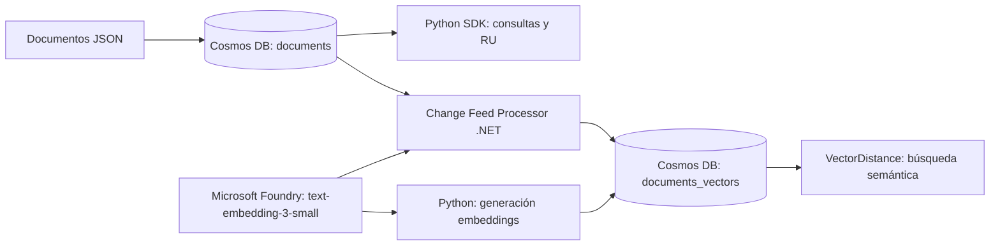

# AI-200 · Azure Cosmos DB para NoSQL, RU, búsqueda vectorial y Change Feed

Repositorio didáctico en **español**, basado en un almacén documental para un asistente RAG. 

El caso usa Azure Cosmos DB for NoSQL, embeddings de un modelo en Microsoft Foundry y un Change Feed Processor en .NET.

## Laboratorios

| Laboratorio | Objetivo | Aplicación |
|---|---|---|
| [01 - SDK y consultas](labs/01-sdk-consultas.md) | Crear recursos, insertar documentos, leer por clave y ejecutar SQL parametrizado | Python |
| [02 - Índices y RU](labs/02-indices-ru.md) | Comparar consultas y costos RU, índices de rango y compuesto; consistencia | Python |
| [03 - Embeddings y búsqueda semántica](labs/03-vectores.md) | Generar embeddings con Foundry y consultar `VectorDistance` | Python |
| [04 - Change Feed Processor](labs/04-change-feed.md) | Detectar inserts y updates, mantener la colección vectorial sincronizada | .NET 8 |

Los cuatro laboratorios se pueden realizar consecutivamente con **un solo Cosmos DB account (recurso)** y cuatro contenedores. 

La creación de cuenta puede tardar varios minutos. 

El worker .NET se ejecuta localmente para observar el procesamiento. No necesita hospedaje adicional.

## Arquitectura



## Requisitos

- Suscripción Azure con permisos para crear recursos y acceder a las claves de Cosmos DB (simplificación de laboratorio).
- Azure CLI actualizado y sesión iniciada, Python 3.10+ y .NET SDK 8 para la cuarta práctica.
- Modelo de embeddings **`text-embedding-3-small` con 1536 dimensiones** desplegado en un recurso de Microsoft Foundry / Azure OpenAI compatible con el endpoint `/openai/v1/`; región y cuotas disponibles. Utiliza el endpoint de inferencia OpenAI del recurso.
- Permiso de invocación al modelo mediante el rol `Cognitive Services OpenAI User`, o equivalente adecuado para el recurso. Se usa Microsoft Entra ID, sin API key de Foundry.
- Acceso a red pública del Cosmos DB account y Foundry durante la práctica; después endurecer reglas de red para producción.
- Cuenta Cosmos DB con capacidad RU/s; el ejercicio **genera costos** de Cosmos DB y consumo de tokens del modelo.

## Preparación local (desde el directorio raíz)

```bash
python -m venv .venv
source .venv/bin/activate
python -m pip install -r requirements.txt
cp .env.example .env
az login
```

En Windows PowerShell usa `.venv\\Scripts\\Activate.ps1` y `Copy-Item .env.example .env`. 

Los comandos Azure CLI de las prácticas se presentan en Bash para facilitar copiar y ejecutar.

## Secuencia recomendada

1. Ejecutar el [Laboratorio 1](labs/01-sdk-consultas.md) para crear recursos y documentos.
2. Ejecutar el [Laboratorio 2](labs/02-indices-ru.md) para crear el contenedor de comparación.
3. Ejecutar el [Laboratorio 3](labs/03-vectores.md) para crear el índice vectorial, conectar Foundry e indexar documentos.
4. Ejecutar el [Laboratorio 4](labs/04-change-feed.md) para detectar actualizaciones con el procesador administrado.

## Consideraciones técnicas

- El SDK Python no incluye la biblioteca **Change Feed Processor** administrada con leases; sí ofrece Change Feed *pull*. Por esa razón el laboratorio 4 emplea el SDK .NET, de acuerdo con Microsoft Learn.
- No se afirma que cambiar la política de indexación siempre reduzca el RU de cada consulta. El laboratorio mide RU por comparación, a costa de las condiciones de una muestra pequeña. Un índice reducido puede penalizar consultas sobre propiedades no indexadas.
- `quantizedFlat` requiere corpus suficiente para aprovechar todo su potencial; en un conjunto pequeño las búsquedas pueden comportarse de forma similar a una exploración. En producción hay que evaluar precisión, consumo y tamaño de corpus.
- La política vectorial y su ruta deben definirse al **crear** el contenedor vectorial. El modelo y las dimensiones deben coincidir.
- **Se usan claves de Cosmos DB solo para acortar el laboratorio local.** En un proyecto empresarial, opta por Entra ID con roles de plano de datos y limitar privilegios, no guardar claves en repositorios.
- El modo de Change Feed utilizado es *latest version*: **no entrega eventos de eliminación**, por lo que esta práctica sincroniza inserciones y actualizaciones, no eliminaciones.

## Eliminación de recursos

Al terminar **todas** las prácticas, ejecuta los comandos de limpieza de [labs/05-limpieza.md](labs/05-limpieza.md). Elimina también el deployment de embeddings solo si lo creaste exclusivamente para estos laboratorios.

## Documentación oficial

- https://learn.microsoft.com/en-us/azure/cosmos-db/nosql/how-to-python-vector-index-query
- https://learn.microsoft.com/en-us/azure/cosmos-db/change-feed-processor
- https://learn.microsoft.com/en-us/azure/cosmos-db/change-feed-pull-model
- https://learn.microsoft.com/en-us/azure/foundry/openai/how-to/embeddings
- https://learn.microsoft.com/en-us/cli/azure/cosmosdb/sql/container
